# WireGuard private access lab

A small lab that recreates how connector-based private access works, then extends it with MFA on the identity side and a test from an Android phone.

- **Part 1:** A user on a Windows laptop reaches an internal web app through a WireGuard tunnel, without that app being exposed. I broke the setup four ways and diagnosed each one with `wg show`, `tcpdump`, iptables counters, and the Windows routing table.
- **Part 2:** Keycloak in Docker, where a test user must enter a one-time code from an authenticator app after the password.
- **Part 3:** A WireGuard tunnel from a Redmi Note 11S (Android 13) to a WireGuard server on Windows, including the network problem that blocked the first attempt.

I built this to get hands-on with WireGuard after working with IPsec (IKEv2) tunnels in production.

## Architecture

**Part 1: connector**

```
Windows 10 (WireGuard app)  --tunnel, UDP 51820-->  WSL2 Ubuntu (connector)  -->  namespace "private"
10.99.0.2                                           wg0: 10.99.0.1                  10.20.0.2:8080 (web app)
                                                    veth-conn: 10.20.0.1
```

**Part 3: phone**

```
Redmi Note 11S (WireGuard app)  --Wi-Fi, UDP 51820-->  Windows 10 host (wg-server)
10.88.0.2                                               192.168.100.2, tunnel address 10.88.0.1
```

| Component | Role |
|---|---|
| Windows WireGuard app | The client, as an end user would run it |
| WSL2 Ubuntu 24.04 | The connector. It terminates the tunnel and routes traffic into the private network |
| Linux network namespace `private` | Stands in for an internal network. Windows has no route to it except through the tunnel |
| veth pair | A virtual cable between the connector and the private network |
| Python http.server | The internal app |
| Keycloak 26.8.1 (Docker) | Identity provider that enforces MFA for the test user |
| Redmi Note 11S | Android client for Part 3 |

| Network | Purpose |
|---|---|
| 10.99.0.0/24 | Part 1 tunnel addresses |
| 10.20.0.0/24 | Private network |
| 10.88.0.0/24 | Part 3 phone tunnel addresses |

## Key ideas

WireGuard compared with IPsec, which I already knew:

| | IPsec (IKEv2) | WireGuard |
|---|---|---|
| Ports | UDP 500 and 4500, plus ESP | One UDP port (51820 here) |
| Crypto | Negotiated by IKE in phases | Fixed (Curve25519, ChaCha20-Poly1305) |
| Identity | Certificates or pre-shared keys | One key pair per peer |

AllowedIPs does two jobs. When sending, it acts as a routing table that decides which destinations go into the tunnel. When receiving, it acts as an access list that decides which source IPs a peer may use. Split tunneling is just a choice of AllowedIPs.

WireGuard does not reply to packets it can't authenticate. A wrong key or a blocked port produces silence, not an error. The first thing to check is the `latest handshake` line in `wg show`. No handshake points to keys, the endpoint, or a firewall. A handshake with no traffic points to AllowedIPs, routing, or forwarding.

## Part 1: Connector and troubleshooting

### 1. Install and generate keys

```bash
sudo apt install -y wireguard-tools tcpdump
sudo modprobe wireguard
umask 077
wg genkey | tee connector.key | wg pubkey > connector.pub
```

The WSL2 kernel ships WireGuard as a module (`CONFIG_WIREGUARD=m`), so it only needed loading. The Windows app generates its own key pair. Only public keys were exchanged between the two sides.

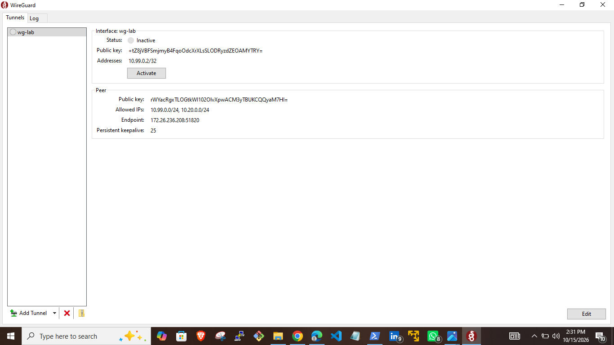

### 2. Bring up the connector

Config files are in [configs/](configs/), with keys replaced by placeholders.

```bash
sudo wg-quick up wg0
sudo wg show
```

Before the client connects, the peer is listed with no endpoint and no handshake.

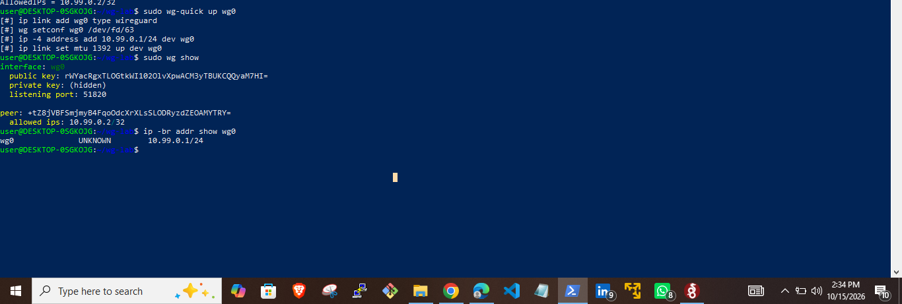

### 3. First handshake

I activated the tunnel on Windows and pinged 10.99.0.1 while capturing on the connector.

```bash
sudo tcpdump -ni eth0 udp port 51820
```

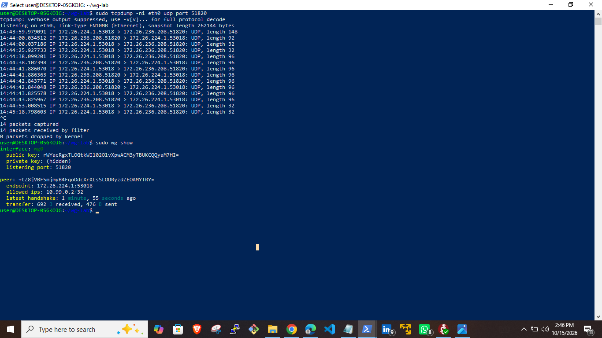

WireGuard packet sizes are fixed, so tcpdump shows what is happening without decrypting anything:

| Length | Packet |
|---|---|
| 148 | Handshake initiation |
| 92 | Handshake response |
| 32 | Keepalive |
| 96 | Data (here, an encrypted ping) |

The connector learned the client's endpoint from the handshake. I never configured it. If the client's address or port changes, WireGuard updates it on the next valid packet.

### 4. Private network and app

[scripts/setup-private-network.sh](scripts/setup-private-network.sh) creates the namespace, the veth pair, the routes, and the web app. The namespace's default route points at the connector, so replies to 10.99.0.2 find their way back through the tunnel. There is no NAT, so the app sees the client's tunnel IP.

The app loading in the browser on Windows, with every packet crossing both `wg0` and `veth-conn`:

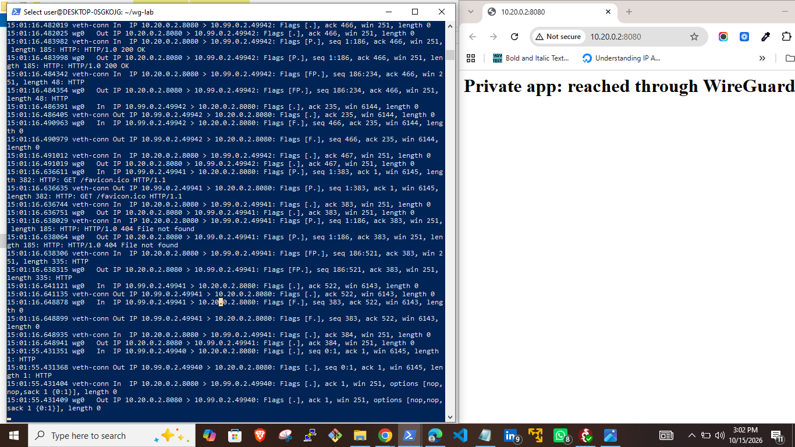

With the tunnel deactivated, the app is unreachable:

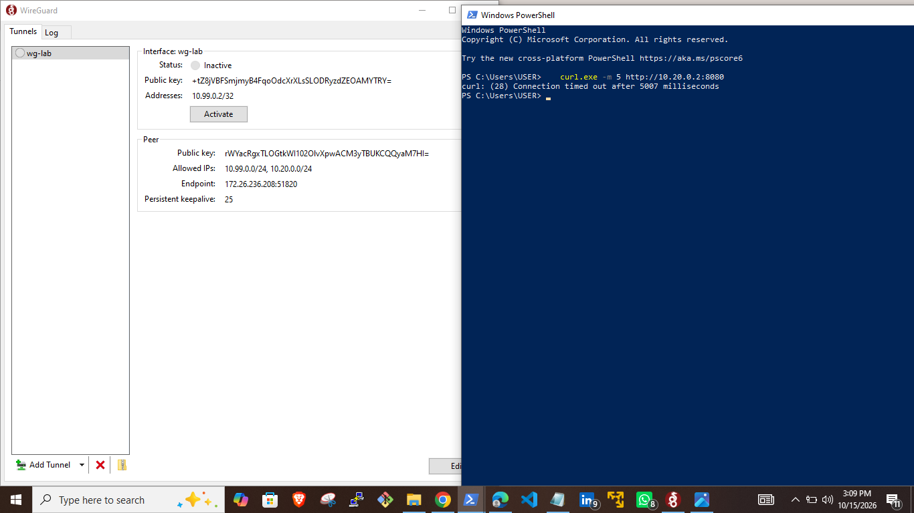

### 5. Split tunneling

```powershell
Find-NetRoute -RemoteIPAddress 10.20.0.2 | Select-Object -Last 1 InterfaceAlias, DestinationPrefix
Find-NetRoute -RemoteIPAddress 8.8.8.8 | Select-Object -Last 1 InterfaceAlias, DestinationPrefix
```

Private traffic goes through `wg-lab`. Internet traffic stays on Wi-Fi. Windows created the 10.20.0.0/24 route from the client's AllowedIPs.

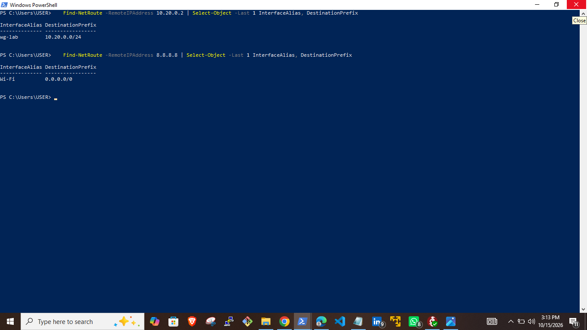

Setting AllowedIPs to `0.0.0.0/0` would make it a full tunnel, sending all traffic through the connector. The connector would then need NAT to reach the internet. I didn't test this, because this connector has no internet path of its own.

### Troubleshooting scenarios

For each break, I looked for where the packets stop before deciding on a cause.

#### Wrong public key

I replaced the client's public key on the connector with a random one using `wg set`.

The ping failed. tcpdump showed 148-byte handshake initiations every few seconds with no 92-byte response. In `wg show`, the peer had no endpoint, no handshake, and no transfer, because the connector never accepted a packet from it. Comparing the public keys on both sides showed the mismatch.

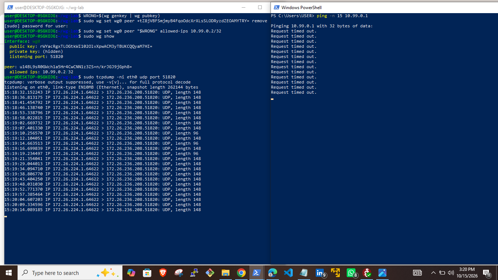

The fix was reloading the config without taking the interface down, so other peers stayed connected:

```bash
sudo bash -c 'wg syncconf wg0 <(wg-quick strip wg0)'
```

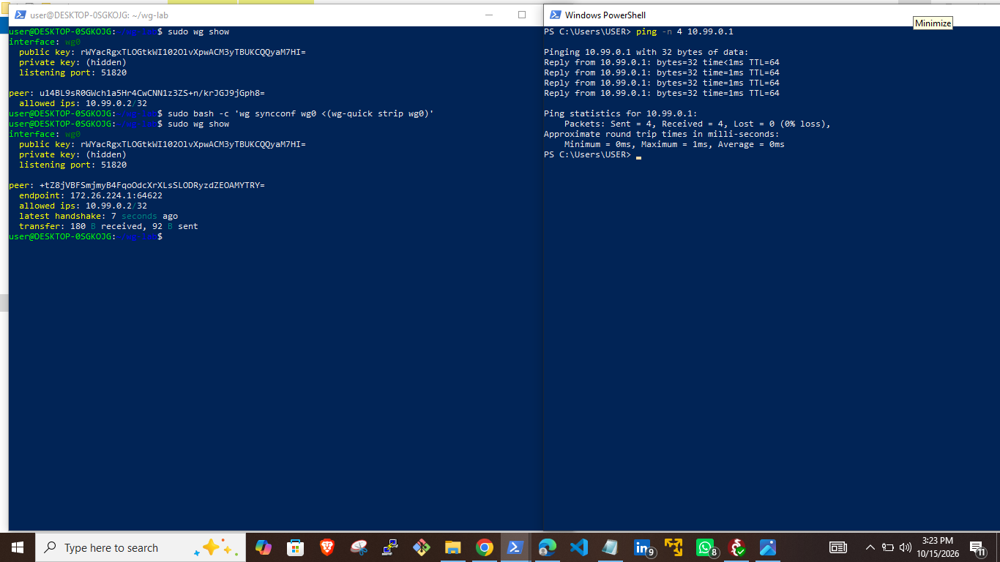

#### Blocked port

```bash
sudo iptables -I INPUT -p udp --dport 51820 -j DROP
```

tcpdump looked almost identical to the wrong-key case: packets arriving and nothing going out. tcpdump captures before the firewall, so it can't tell the two apart. The DROP rule's packet counter went from 1 to 35, which proved it was the firewall.

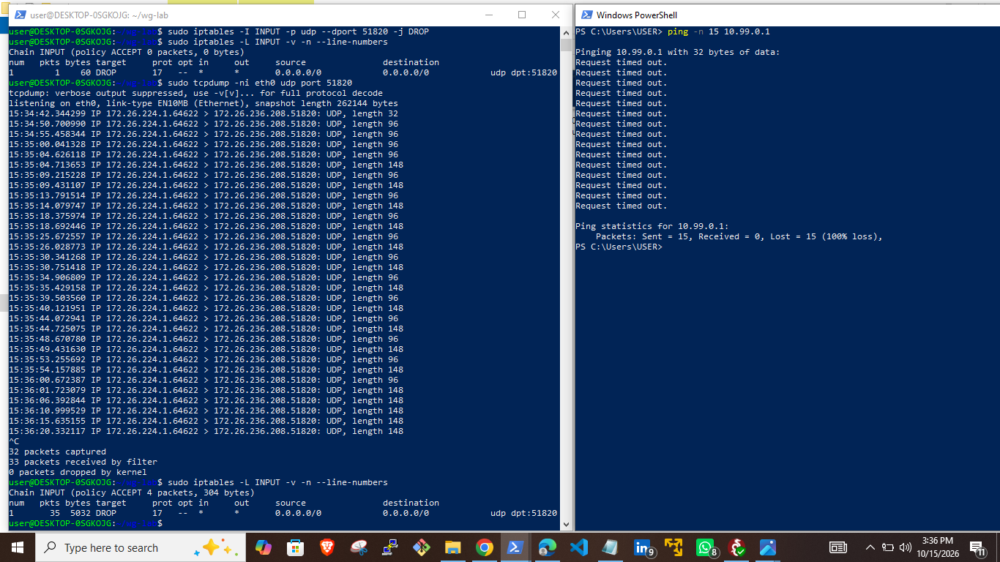

I removed the rule by its specification rather than its line number, since line numbers shift when other rules change.

```bash
sudo iptables -D INPUT -p udp --dport 51820 -j DROP
```

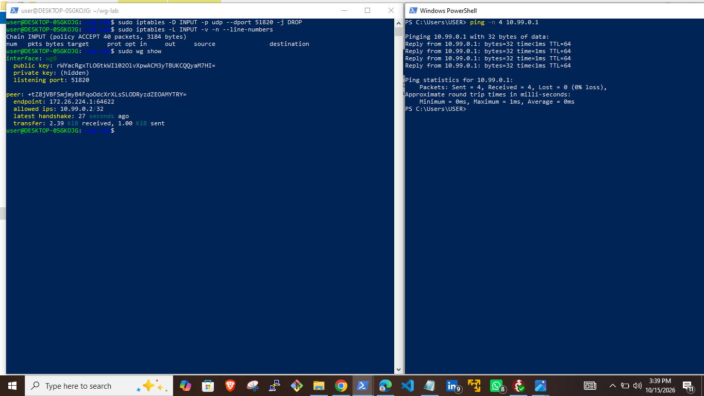

On a cloud VM, a security group blocks traffic before it reaches the server, so tcpdump would show nothing at all. Empty tcpdump points to a cloud firewall or routing problem. Packets in with no reply points to the host firewall or the keys.

#### Client AllowedIPs missing the private subnet

I removed 10.20.0.0/24 from the client's AllowedIPs. From the user's side, the VPN was connected and the gateway answered pings, but the app wouldn't load.

The handshake was fresh, but tcpdump on the connector captured 0 packets, and `Find-NetRoute` showed 10.20.0.2 going out via Wi-Fi. The request never entered the tunnel.

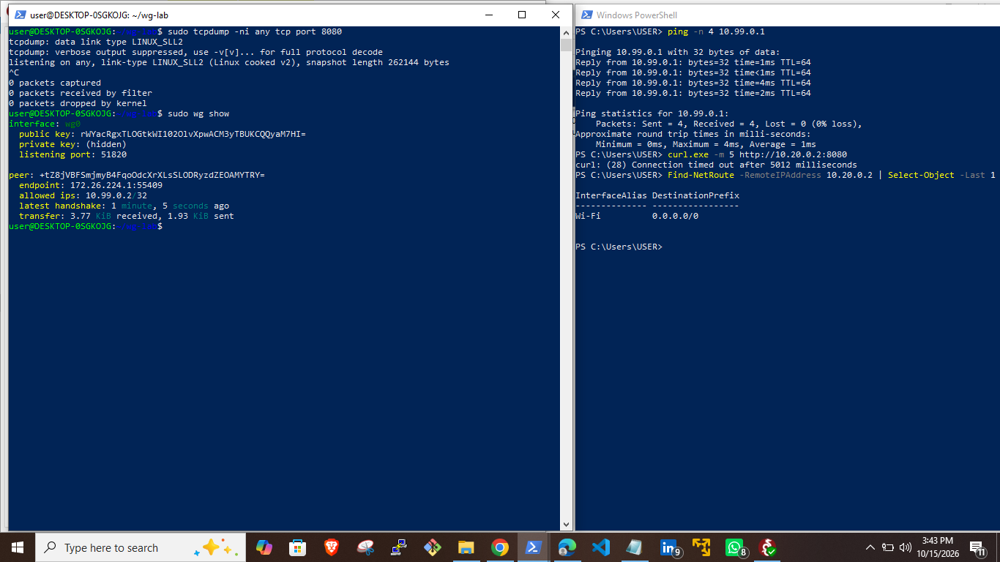

Adding the subnet back fixed it:

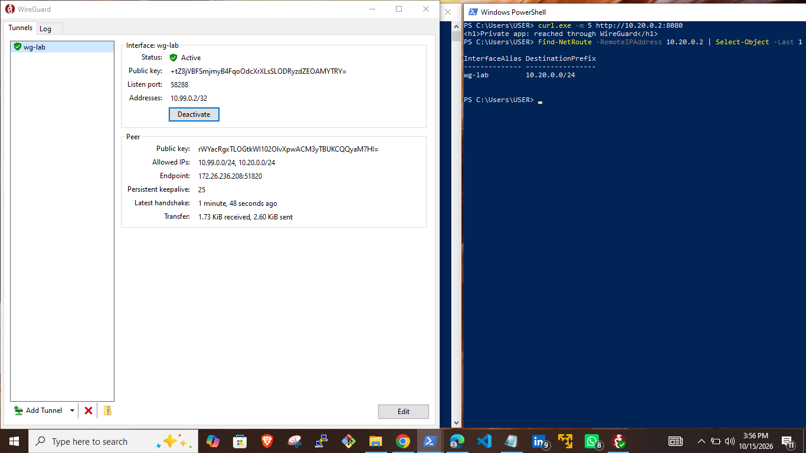

#### IP forwarding off

This one happened on the first attempt to reach the app. Ubuntu has `net.ipv4.ip_forward = 0` by default, so the connector acted as a host, not a router.

tcpdump showed TCP SYNs arriving on `wg0 In`, retransmitted with the same sequence number, and nothing on `veth-conn Out`. The packets reached the connector and stopped there.

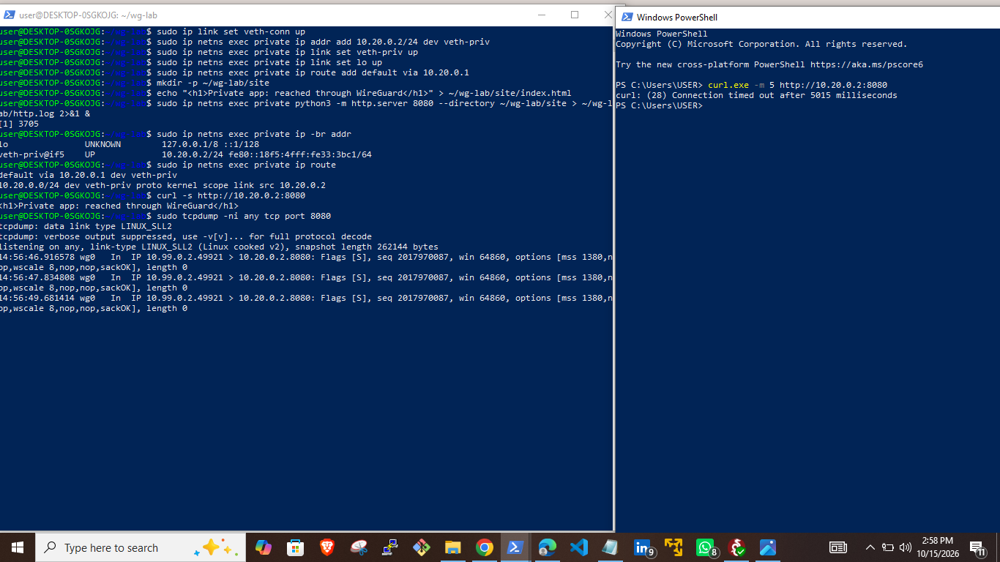

```bash
sudo sysctl -w net.ipv4.ip_forward=1
```

`sysctl -w` doesn't survive a reboot. In production, the setting belongs in a file under `/etc/sysctl.d/`.

#### Summary

| Symptom | Where packets stop | Cause | Evidence |
|---|---|---|---|
| No handshake | Arrive at connector, no reply | Wrong key | Peer has no endpoint or handshake, keys don't match |
| No handshake | Arrive, then dropped | Host firewall | iptables DROP counter rising |
| Handshake OK, app unreachable | Arrive on `wg0`, not forwarded | IP forwarding off | `wg0 In` with no `veth-conn Out` |
| Handshake OK, app unreachable | Never leave the laptop | Client AllowedIPs | Empty tcpdump, route via Wi-Fi |

## Part 2: MFA with Keycloak

Keycloak runs in Docker, with a `vpn-lab` realm and a test user who must enter a one-time code after the password.

### Steps

1. Start Keycloak (PowerShell). Replace the placeholder with your own admin password, and don't commit it.

   ```powershell
   docker run -d --name keycloak -p 8080:8080 -e KC_BOOTSTRAP_ADMIN_USERNAME=admin -e KC_BOOTSTRAP_ADMIN_PASSWORD=<ADMIN_PASSWORD> quay.io/keycloak/keycloak:latest start-dev
   ```

2. Check the logs for `Listening on: http://0.0.0.0:8080`:

   ```powershell
   docker logs keycloak --tail 20
   ```

3. Open `http://localhost:8080`, sign in with the temporary admin, and create a permanent admin account. Sign in as the new admin and delete the temporary one.
4. Create a realm called `vpn-lab`.
5. Create a user called `testuser`, set a password, and turn off **Temporary**.
6. Under **Authentication**, open the **Browser** flow and set **OTP Form** to **Required**.
7. Under the user's **Details** tab, add **Configure OTP** to **Required user actions**.
8. Open `http://localhost:8080/realms/vpn-lab/account` in a private window, sign in as `testuser`, scan the QR code with an authenticator app, and enter the code.

The enrolled authenticator appears under **Account security > Signing in**, in the Two-factor authentication section.

Keycloak `start-dev` keeps its data inside the container, so don't remove the container while you're using the lab.

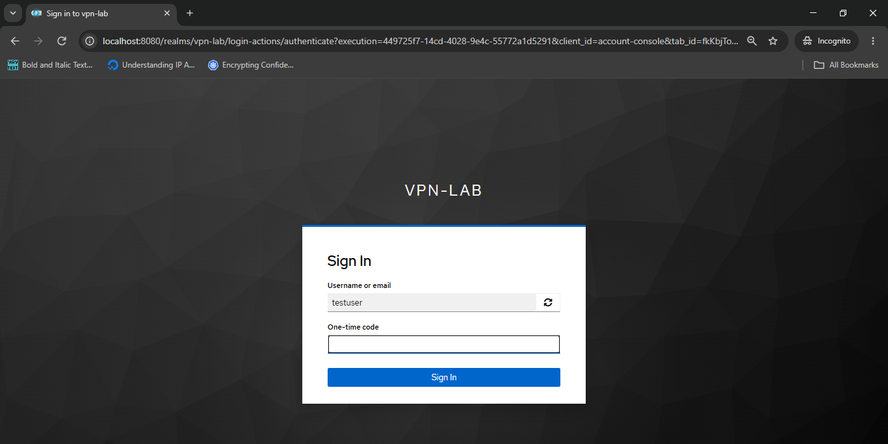

## Part 3: Android client test

The phone connects to a WireGuard server running on Windows. This is a workaround, not the Linux connector from Part 1. The connector runs in WSL2, and the phone couldn't reach it (see Issues below).

### Configs

**Windows server (`wg-server`):**

```ini
[Interface]
PrivateKey = <WINDOWS_SERVER_PRIVATE_KEY>
Address = 10.88.0.1/24
ListenPort = 51820

[Peer]
PublicKey = <PHONE_PUBLIC_KEY>
AllowedIPs = 10.88.0.2/32
```

**Phone (`phone-lab`):**

```ini
[Interface]
PrivateKey = <PHONE_PRIVATE_KEY>
Address = 10.88.0.2/32

[Peer]
PublicKey = <WINDOWS_SERVER_PUBLIC_KEY>
Endpoint = 192.168.100.2:51820
AllowedIPs = 10.88.0.0/24
PersistentKeepalive = 25
```

The Windows server and the phone each need the other's public key. Label the keys as you copy them, since the two are easy to mix up.

### Firewall rule

Windows Firewall blocked inbound UDP 51820 from the phone. Open it for the Public profile, which is the profile my Wi-Fi uses (admin PowerShell):

```powershell
New-NetFirewallRule -DisplayName "WireGuard lab inbound UDP 51820" -Direction Inbound -Protocol UDP -LocalPort 51820 -Action Allow -Profile Public
```

Remove it after testing:

```powershell
Remove-NetFirewallRule -DisplayName "WireGuard lab inbound UDP 51820"
```

### Results

The Windows log shows the handshake from the phone (`192.168.100.5`), the keypairs being created, and keepalives afterward:

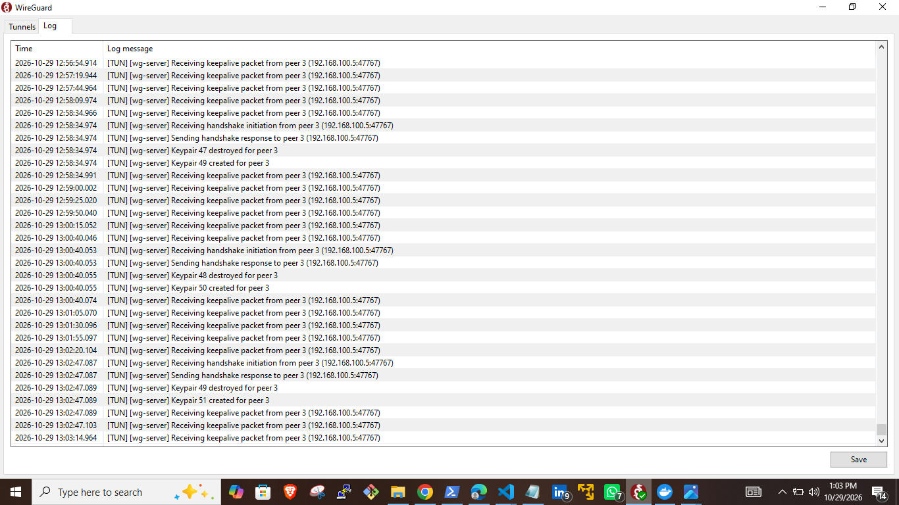

The phone's Transfer counters show the tunnel passing traffic:

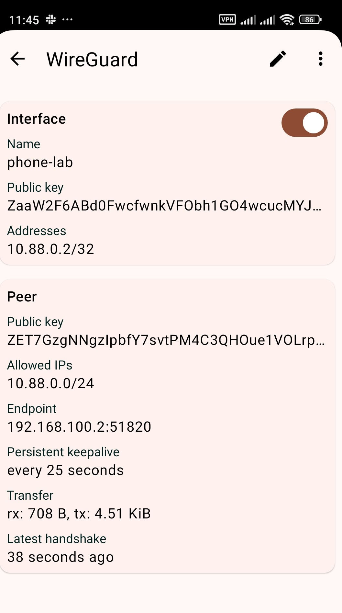

### Issues encountered

- **Packets stopped before reaching WSL.** `tcpdump` in WSL captured only the Windows client's packets. WSL2 uses NAT, and Windows didn't forward inbound UDP from the Wi-Fi network to it.
- **Port proxy didn't help.** `netsh interface portproxy` was empty, and it only forwards TCP, so it can't carry WireGuard's UDP traffic anyway.
- **Mirrored networking not available.** WSL reported that mirrored networking needs Windows features missing from this build (19045), so it fell back to NAT.
- **"Invalid MAC of handshake."** The phone was encrypting to the wrong server public key because I had copied it incorrectly. Copying the key directly from the app, instead of retyping it, fixed the problem. The log then showed the handshake succeeding.

## Still to do

- OpenVPN and IPsec/IKEv2 comparison
- Bandwidth and MTU tests (`iperf3`, `tc netem`)
- MFA with Entra ID and Google Workspace

## Running it again

Part 1, after a WSL restart:

```bash
ip -br addr show eth0          # the WSL IP can change, update the client Endpoint if it did
sudo wg-quick up wg0
./scripts/setup-private-network.sh
```

Part 2: start the Keycloak container with `docker start keycloak`.

Part 3: activate `wg-server` on Windows, make sure the firewall rule exists, and switch on `phone-lab`.

## What I'd add next

- Run the connector on a cloud VM, with a security group in place of iptables
- Make the connector dial out, so no inbound port is needed (how most commercial connectors work)
- Put the Keycloak MFA check in front of the private app
- Add a second client to see per-peer AllowedIPs on the connector